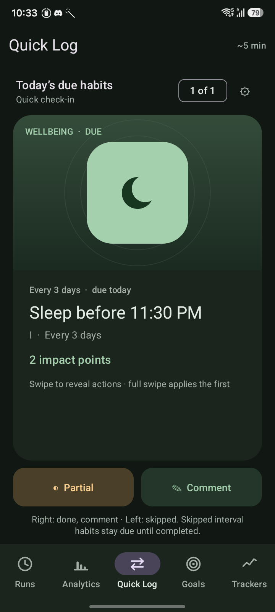
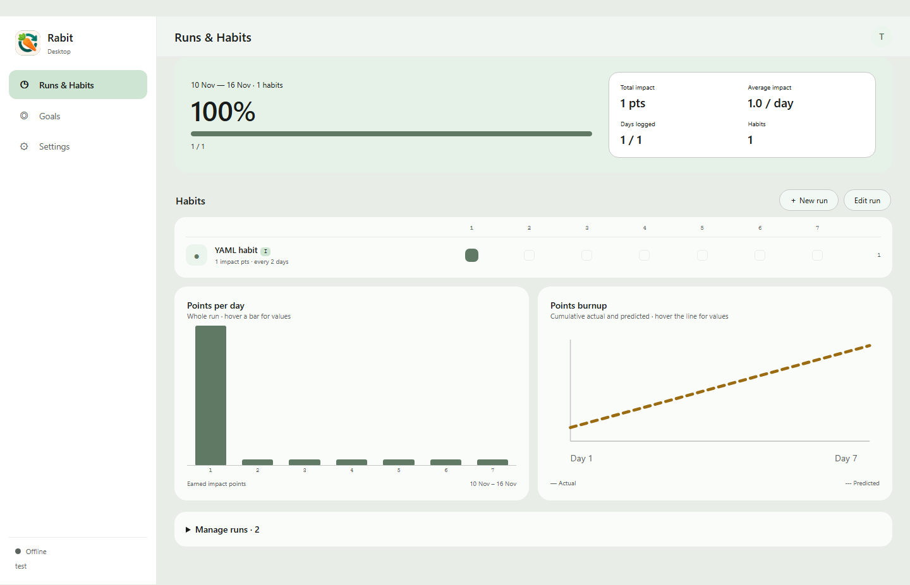

# Rabit — Habit and Goals Tracker

Build a routine one day at a time. Rabit helps you plan a habit run, check in each day, and see how your progress adds up. Use the Android app offline or connect it to a self-hosted server and browser app.

## What you can do

- **Plan a run:** choose its length and habits, then track each day in one place.
- **Check in quickly:** record a habit as done, partial, or skipped, with an optional note.
- **See your progress:** review daily completion, impact points, and run charts.
- **Keep control of your data:** use Android offline, or sync through a server you host.
- **Share an update:** on Android, choose which habits can appear in a copied daily text summary. Sharing choices currently stay on that device.

## Screenshots

<table>
  <tr>
    <td align="center"> Quick Log on Android</td>
    <td align="center"> Runs and progress in the browser</td>
  </tr>
</table>

These screenshots show earlier builds; some controls and labels have since changed.

## Get started

**Android:** Download the signed [Rabit 1.1.1 APK](https://github.com/CreativeCheebs/Rabit-Habit-Tracker/releases/tag/v1.1.1). Open Rabit and choose offline use or connect to your own sync server.

**Browser:** The web app is included with the self-hosted sync server. Follow the [Docker setup guide](docs/docker.md), then open your server's address in a browser and create an account.

Rabit is open source. For build instructions, server configuration, API details, and contributor tooling, see the [developer guide](docs/developer-guide.md).
